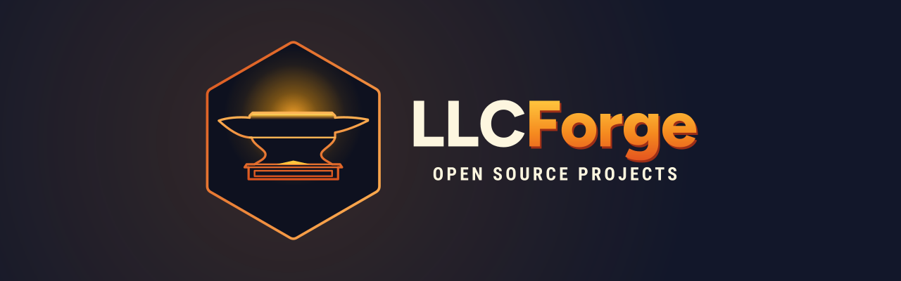

<!--
  LLCForge profile README
  Put the contents of this folder at the root of a PUBLIC repository named exactly "LLCForge"
  (LLCForge/LLCForge). The assets/ folder already contains the banner and badge referenced below.
-->

  

<h1 align="center">LLCForge</h1>

  <strong>Where our internal tools are hammered into open source.</strong> 
  Self-hostable, privacy-first software — built for our own use, released for everyone.

  
  
  
  

---

## What is LLCForge?

LLCForge is the open-source home for the systems we build and run ourselves.
Everything published here started as a tool we needed in our own work. When a piece
proves useful on its own, we clean it up, document it and release it — the way a smith
heats, hammers and finishes a piece before it leaves the forge.

We care about a few things more than anything else:

| Principle | What it means in practice |
|---|---|
| **Self-hostable by default** | Every project runs on your own hardware with a single binary or a `docker compose up`. No mandatory SaaS, no license server. |
| **Privacy-first** | No telemetry, no phone-home, no accounts. If a feature needs the network, the README says exactly where it connects. |
| **Small surface, sharp edges** | Few dependencies, clear configuration, boring and auditable code. Security-relevant paths are documented. |
| **Documented like we mean it** | A project is not "done" until its README lets a stranger run it in five minutes. |
| **Permissive licenses** | MIT or Apache-2.0 unless a repository states otherwise. Use it, fork it, ship it. |

## What you will find here

Repositories land here as they are cleaned up for release, roughly in these areas:

- **Infrastructure & networking** — tooling for running your own servers and networks
- **Security** — defensive components that assume the internet is hostile
- **Automation** — scripts and services that remove repetitive operations work
- **Developer tooling** — utilities we use every day while building the above

Every repository carries its own README, changelog and license, and tells you plainly
what it does, how to run it and what it does *not* do.

## Tech we reach for

  
  
  
  
  
  
  

## How we work

- **Releases are tagged and signed.** Every release has a changelog, prebuilt binaries where it makes sense, and checksums.
- **Main is always deployable.** Work happens on branches; pull requests need green CI and one review.
- **Conventional commits** (`feat:`, `fix:`, `docs:`, `refactor:`…) keep history readable and changelogs automatic.
- **Issues are triaged weekly.** Bugs come first, then docs, then features. Good first issues are labelled `good first issue`.
- **Security reports go through a private channel** — see [Security](#security) below, never a public issue.

## Contributing

Contributions of every size are welcome: a typo fix, a reproducible bug report, a benchmark, a new feature behind a flag.

1. **Look before you build.** Check open issues and discussions; for anything larger than a bug fix, open an issue first so we can agree on the approach.
2. **Fork, branch, commit.** Branch from `main`, keep commits focused, follow conventional commits.
3. **Test and document.** Add or update tests, and update the README/docs if behaviour changes.
4. **Open a pull request.** Describe *what* and *why*; link the issue. CI must pass. We aim to respond within a few days.

Each repository has its own `CONTRIBUTING.md` with project-specific details (toolchain versions, how to run the test suite, code style). By contributing you agree that your contributions are licensed under the repository's license.

## Security

If you believe you have found a security vulnerability in any LLCForge project, **please do not open a public issue.**
Use GitHub's private vulnerability reporting ("Report a vulnerability" under the repository's *Security* tab).
We acknowledge reports within 72 hours, keep you informed while we fix the issue, and credit you in the advisory unless you prefer otherwise.

## Community

- 💬 **Discussions** — questions, ideas and show & tell, in the *Discussions* tab of each repository
- 🐛 **Issues** — bug reports and feature requests, on the repository they belong to
- ⭐ **Stars and watches** — the simplest way to tell us a project is worth our time

## License

Unless a repository states otherwise, LLCForge projects are released under the **MIT License** or the **Apache License 2.0** — check the `LICENSE` file in each repository. Brand assets (the LLCForge name, hexagon-and-anvil mark and wordmark) are not covered by these licenses and may not be used to imply endorsement.

---

   
  <strong>Heat. Hammer. Ship.</strong> — forged in the open since 2026.

