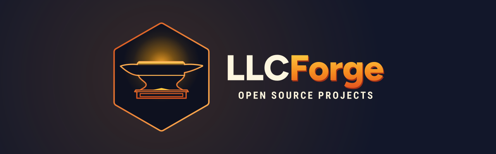

<!--
  LLCForge profil README'si (Türkçe sürüm)
  İngilizce sürüm README.md olarak kullanılır; bunu README.tr.md olarak yanına koyup
  üstten birbirine link verebilirsiniz.
-->

  

<h1 align="center">LLCForge</h1>

  <strong>Kendi iç araçlarımızın açık kaynağa dövüldüğü yer.</strong> 
  Kendi sunucunuzda çalışan, gizlilik öncelikli yazılım — kendi işimiz için yapıldı, herkes için yayımlandı.

  <a href="README.md">English</a> · <strong>Türkçe</strong>

---

## LLCForge nedir?

LLCForge, kendimiz geliştirip çalıştırdığımız sistemlerin açık kaynak evidir.
Burada yayımlanan her şey önce kendi işimizde ihtiyaç duyduğumuz bir araç olarak doğdu.
Bir parça tek başına işe yarar hale geldiğinde onu temizliyor, belgeliyor ve yayımlıyoruz —
bir demircinin parçayı ocaktan çıkarmadan önce ısıtıp dövüp bitirmesi gibi.

Her şeyden çok önem verdiğimiz birkaç ilke var:

| İlke | Pratikte anlamı |
|---|---|
| **Varsayılan olarak self-hosted** | Her proje tek bir binary veya `docker compose up` ile kendi donanımınızda çalışır. Zorunlu SaaS yok, lisans sunucusu yok. |
| **Gizlilik öncelikli** | Telemetri yok, eve telefon yok, hesap yok. Bir özellik ağa çıkıyorsa README tam olarak nereye bağlandığını söyler. |
| **Küçük yüzey, keskin kenarlar** | Az bağımlılık, net yapılandırma, sıkıcı ve denetlenebilir kod. Güvenlikle ilgili yollar belgelidir. |
| **Gerçekten belgelenmiş** | Bir proje, README'si bir yabancının onu beş dakikada çalıştırmasını sağlamadan "bitmiş" sayılmaz. |
| **Serbest lisanslar** | Depo aksini belirtmedikçe MIT veya Apache-2.0. Kullanın, çatallayın, ürüne koyun. |

## Burada neler bulacaksınız

Depolar yayına hazırlandıkça, kabaca şu alanlarda buraya eklenir:

- **Altyapı ve ağ** — kendi sunucularınızı ve ağlarınızı işletmek için araçlar
- **Güvenlik** — internetin düşmanca olduğunu varsayan savunma bileşenleri
- **Otomasyon** — tekrarlayan operasyon işlerini ortadan kaldıran betikler ve servisler
- **Geliştirici araçları** — yukarıdakileri inşa ederken her gün kullandığımız yardımcılar

Her deponun kendi README'si, değişiklik günlüğü ve lisansı vardır; ne yaptığını, nasıl
çalıştırılacağını ve neyi *yapmadığını* açıkça söyler.

## Kullandığımız teknolojiler

  
  
  
  
  
  
  

## Nasıl çalışıyoruz

- **Sürümler etiketlenir ve imzalanır.** Her sürümün değişiklik günlüğü, gerektiğinde hazır binary'leri ve sağlama toplamları vardır.
- **`main` her zaman yayına hazırdır.** İş dallarda yapılır; pull request'ler yeşil CI ve bir inceleme ister.
- **Conventional commits** (`feat:`, `fix:`, `docs:`, `refactor:`…) geçmişi okunur, değişiklik günlüğünü otomatik tutar.
- **Issue'lar haftalık elden geçirilir.** Önce hatalar, sonra belgeler, sonra özellikler. Yeni başlayanlar için `good first issue` etiketi.
- **Güvenlik bildirimleri özel kanaldan gelir** — aşağıdaki [Güvenlik](#güvenlik) bölümüne bakın; asla açık issue ile değil.

## Katkıda bulunma

Her boyutta katkı memnuniyetle karşılanır: bir yazım hatası düzeltmesi, yeniden üretilebilir bir hata raporu, bir benchmark, bayrak arkasına alınmış yeni bir özellik.

1. **Yapmadan önce bakın.** Açık issue ve tartışmalara göz atın; hata düzeltmesinden büyük her şey için önce issue açın ki yaklaşımda anlaşalım.
2. **Fork, dal, commit.** `main`'den dallanın, commit'leri odaklı tutun, conventional commits kullanın.
3. **Test edin ve belgeleyin.** Test ekleyin/güncelleyin; davranış değişiyorsa README'yi de güncelleyin.
4. **Pull request açın.** *Ne* ve *neden* olduğunu anlatın; issue'ya link verin. CI geçmeli. Birkaç gün içinde yanıt vermeyi hedefliyoruz.

Her deponun kendi `CONTRIBUTING.md` dosyasında projeye özel ayrıntılar (araç zinciri sürümleri, testlerin nasıl koşulacağı, kod stili) bulunur. Katkıda bulunarak katkılarınızın deponun lisansı altında yayımlanmasını kabul etmiş olursunuz.

## Güvenlik

Herhangi bir LLCForge projesinde güvenlik açığı bulduğunuzu düşünüyorsanız **lütfen açık bir issue açmayın.**
GitHub'ın özel zafiyet bildirimini kullanın (deponun *Security* sekmesinde "Report a vulnerability").
Bildirimleri 72 saat içinde yanıtlıyor, düzeltme boyunca sizi bilgilendiriyor ve aksini istemezseniz duyuruda adınıza yer veriyoruz.

## Topluluk

- 💬 **Tartışmalar** — sorular, fikirler ve yaptıklarınızı gösterme; her deponun *Discussions* sekmesinde
- 🐛 **Issue'lar** — hata raporları ve özellik istekleri; ait oldukları depoda
- ⭐ **Yıldız ve takip** — bir projenin zamanımıza değdiğini söylemenin en kolay yolu

## Lisans

Depo aksini belirtmedikçe LLCForge projeleri **MIT Lisansı** veya **Apache Lisansı 2.0** ile yayımlanır — her deponun `LICENSE` dosyasına bakın. Marka varlıkları (LLCForge adı, altıgen-örs amblemi ve yazı logosu) bu lisansların kapsamında değildir ve onay/ortaklık izlenimi verecek şekilde kullanılamaz.

---

   
  <strong>Isıt. Döv. Yayınla.</strong> — 2026'dan beri açıkta dövülüyor.

